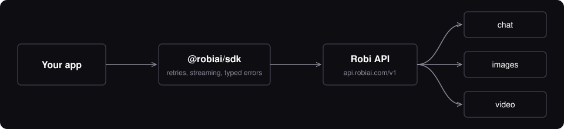

The official TypeScript / JavaScript SDK for the [Robi API](https://console.robiai.com/docs).

[Install](#install) · [Quick start](#quick-start) · [Chat](#chat) · [Images](#images) · [Video](#video) · [Errors](#errors) · [Options](#options)

---

## Why this SDK

| | |
|---|---|
| **One client, three modalities** | `chat`, `images` and `videos` share one key, one base URL and one error model. |
| **Streaming that behaves** | Async-iterator streams. Errors that arrive mid-stream are thrown, not swallowed. |
| **Typed end to end** | Request params, responses, errors and model kinds are all typed. |
| **Zero dependencies** | Built on `fetch`. Runs on Node 18+, browsers, edge runtimes and React Native. |
| **Sensible retries** | Exponential backoff on `429` and `5xx`, honoring `Retry-After`. Never retries `4xx` that won't change. |



## Install

```bash
npm install @robiai/sdk
```

## Quick start

Create a key in the [Robi Console](https://console.robiai.com) (keys look like `sk-…`) and export it:

```bash
export ROBI_API_KEY=sk-...
```

```ts
import Robi from "@robiai/sdk";

const robi = new Robi(); // reads ROBI_API_KEY

const reply = await robi.chat.completions.create({
  model: "lime",
  messages: [{ role: "user", content: "Explain caching in one sentence." }],
});

console.log(reply.choices[0].message.content);
```

> **Server-side only.** Never ship a production key in browser or mobile code. Call Robi from your backend.

## Models

| Model | Kind | Use it for |
|---|---|---|
| `lime` | chat | Large context: long documents and retrieval |
| `vera` | chat | Chat |
| `prism` | image | Image generation and editing |
| `movi` | video | Short clips with sound |

Rates and the live list come from `robi.models.list()`, which includes each model's `kind` and prices.

## Chat

### Basic and streaming

```ts
// Streaming: the last chunk carries `usage` and an empty `choices` array
const stream = await robi.chat.completions.create({
  model: "lime",
  messages: [{ role: "user", content: "Write a haiku about caching." }],
  stream: true,
});

for await (const chunk of stream) {
  process.stdout.write(chunk.choices[0]?.delta?.content ?? "");
}

// Or just collect the text
const text = await robi.chat.completions.text({ model: "lime", messages });
```

<details>
<summary><b>Vision, JSON output and reasoning</b></summary>

```ts
// Images in messages (data URL or public URL)
await robi.chat.completions.create({
  model: "lime",
  messages: [{
    role: "user",
    content: [
      { type: "text", text: "What is in this picture?" },
      { type: "image_url", image_url: { url: "data:image/jpeg;base64,..." } },
    ],
  }],
});

// Force valid JSON (describe the shape in a message too)
await robi.chat.completions.create({
  model: "vera",
  response_format: { type: "json_object" },
  messages: [
    { role: "system", content: 'Reply with JSON like {"city": string, "country": string}.' },
    { role: "user", content: "Where is the Eiffel Tower?" },
  ],
});

// Adjustable reasoning, for models that support it
await robi.chat.completions.create({ model: "lime", reasoning_effort: "high", messages });
```

Any extra field is forwarded to the model unchanged.
</details>

## Images

Images come back as base64 (`b64_json`); there is no `url`.

```ts
import { readFileSync, writeFileSync } from "node:fs";

const img = await robi.images.generate({
  model: "prism",
  prompt: "A red bicycle against a brick wall, golden hour",
  aspect_ratio: "4:5",
  style: "photorealistic",
});
writeFileSync("out.jpg", Buffer.from(img.data[0].b64_json, "base64"));

// Edit or restyle 1-4 reference images (10 MB each)
await robi.images.edit({
  model: "prism",
  prompt: "Replace the background with a studio backdrop",
  image: new Blob([readFileSync("photo.jpg")]),
});
```

<details>
<summary><b>Image options</b></summary>

| Option | Values |
|---|---|
| `n` | 1 to 4 |
| `aspect_ratio` | `1:1` `2:3` `3:2` `3:4` `4:3` `4:5` `5:4` `9:16` `16:9` `21:9` |
| `size` | e.g. `1024x1024` (ignored when `aspect_ratio` is set) |
| `quality` | `standard` (1K), `high` (2K), `ultra` (4K) |
| `style` | `photorealistic` `cinematic` `illustration` `anime` `3d` `watercolor` `line-art` `pixel-art` `isometric` `minimal` |

Every image carries a signed C2PA Content Credential. Re-encoding strips it, so deliver the bytes as returned when provenance matters.
</details>

## Video

Videos render in the background as a job. `createAndPoll` creates it and waits for you.

```ts
const video = await robi.videos.createAndPoll({
  model: "movi",
  prompt: "A red bicycle rolling past a brick wall, golden hour",
  seconds: 8,
  size: "1280x720",
});

writeFileSync("out.mp4", await robi.videos.downloadContent(video.id));
```

```
queued  ->  in_progress  ->  completed
                         \-> failed   (throws VideoFailedError, nothing is charged)
```

<details>
<summary><b>Manual polling, image-to-video, listing</b></summary>

```ts
let v = await robi.videos.create({ model: "movi", prompt: "...", seconds: 6 });
while (v.status === "queued" || v.status === "in_progress") {
  await new Promise((r) => setTimeout(r, 5000));
  v = await robi.videos.retrieve(v.id);
}

// Start from a still image
await robi.videos.create({
  model: "movi",
  prompt: "The camera slowly pushes in as leaves drift across the frame",
  input_reference: new Blob([readFileSync("photo.jpg")]),
  aspect_ratio: "9:16",
});

await robi.videos.list({ limit: 20, order: "desc" });
await robi.videos.delete(v.id);
```

Clips are kept for 24 hours after completion; after that `downloadContent` returns `410`. Seconds run 4 to 8. Video models bill per second.
</details>

## Errors

All errors extend `RobiError`. API errors extend `APIError` and carry `status`, `code`, `type` and `requestId`.

```ts
import { RateLimitError, PaymentRequiredError } from "@robiai/sdk";

try {
  await robi.chat.completions.create({ model: "lime", messages });
} catch (e) {
  if (e instanceof PaymentRequiredError) console.error("Out of credit:", e.message);
  else if (e instanceof RateLimitError) console.error("Slow down");
  else throw e;
}
```

| Status | Class | Retried |
|---|---|---|
| 400, 422 | `BadRequestError` | no |
| 401 | `AuthenticationError` | no |
| 402 | `PaymentRequiredError` | no |
| 403 | `PermissionDeniedError` | no |
| 404 | `NotFoundError` | no |
| 413 | `PayloadTooLargeError` | no |
| 429 | `RateLimitError` | yes |
| 5xx | `InternalServerError` | yes |
| network / timeout | `ConnectionError` / `TimeoutError` | yes |

## Options

```ts
const robi = new Robi({
  apiKey: "sk-...",                    // default: process.env.ROBI_API_KEY
  baseURL: "https://api.robiai.com/v1", // default: process.env.ROBI_BASE_URL
  maxRetries: 2,
  timeout: 60_000,                     // ms per request
  fetch: customFetch,                  // proxies, tests, React Native
  defaultHeaders: {},
});

// Cancel any call
const ctrl = new AbortController();
robi.chat.completions.create({ model: "lime", messages }, { signal: ctrl.signal });
```

Reasoning models can take 30 seconds or more to send a first token. That is normal, so keep the default timeout generous for them.

## Development

```bash
npm install
npm test
npm run build
```
